# 智能记账助手 (Accounting Assistant)

<div align="center">

[](LICENSE)
[](https://openjdk.org/)
[](https://spring.io/projects/spring-boot)
[](https://vuejs.org/)
[](https://tewit1yi-java-accounting-assistant.apps-5.websson.cloud)

一个前后端一体的智能记账应用，使用自然语言即可完成记账。

**🚀 在线演示：** <https://tewit1yi-java-accounting-assistant.apps-5.websson.cloud>（注册账号即可体验，无需本地部署）

[特性](#特性) • [界面预览](#界面预览) • [快速开始](#快速开始) • [部署](#部署) • [文档](#文档) • [贡献](#贡献)

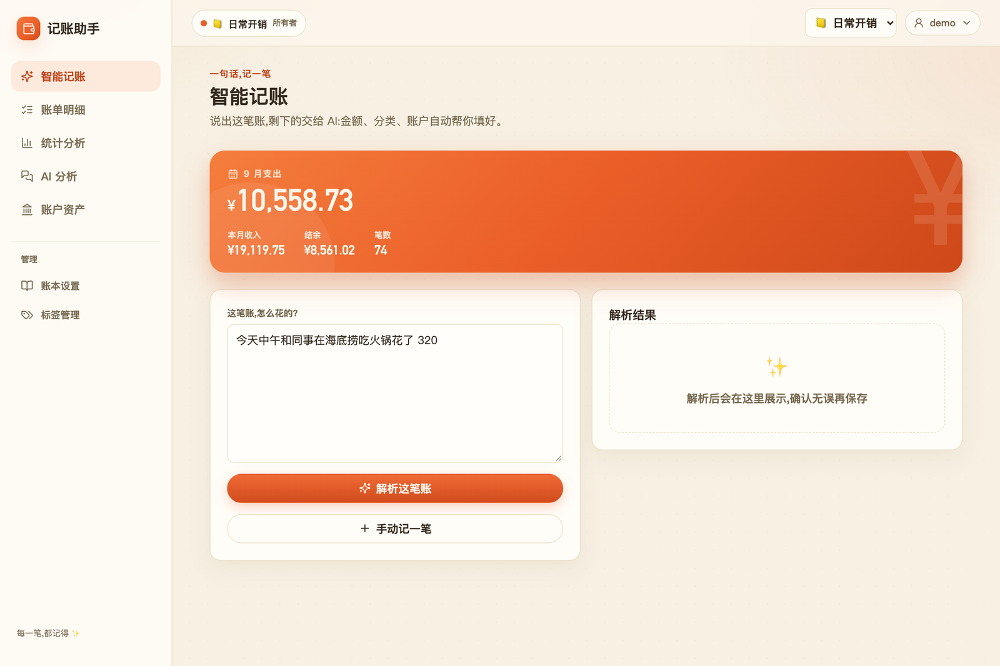

</div>

## 特性

**AI 自然语言解析** - 输入"今天中午和同事在海底捞吃火锅花了320"，自动提取金额、类型、商户、分类

**AI 截图记账** - 上传消费或收入截图，自动提取多笔交易并匹配分类、账户，逐笔核对后保存；支持桌面和移动端，配置支持图片输入的模型后可开启

**AI 智能分析** - 用自然语言提问"本月餐饮花了多少"、"收入最多的是哪个月"，AI 自动生成数据分析

**多账本管理** - 创建多个账本（个人、家庭、旅行），邀请成员，不同角色权限

**账户管理** - 支持银行卡、支付宝、微信、现金等多账户，账户间转账

**标签系统** - 自定义标签 + 系统预置标签，按标签筛选

**统计分析** - 收支汇总（含环比）、分类构成饼图、月度/每日趋势图、大额支出排行

**手机与桌面体验** - 统一记账面板、Tab 状态与滚动恢复、自动草稿、局部加载与重试

**安装与断网使用** - 添加到主屏幕后独立打开，查看最近缓存的数据，普通收支可保存到本机待同步队列

**CSV 导入导出** - 支持外部数据导入，支持按条件筛选导出

**安全可靠** - 密码加密存储、Session + Remember-me 双重登录态、CSRF 防护

**SQLite 数据库** - 零配置，备份就是复制一个文件

## 界面预览

### 桌面端

| 登录 | 智能记账 |
|:---:|:---:|
| 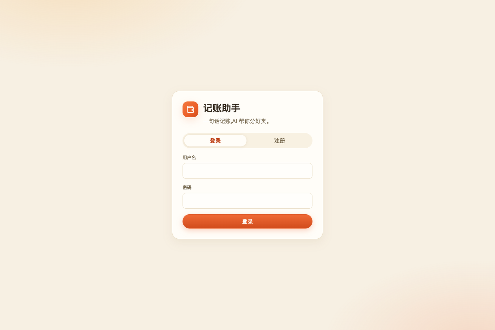 |  |
| **账单明细** | **统计分析** |
| 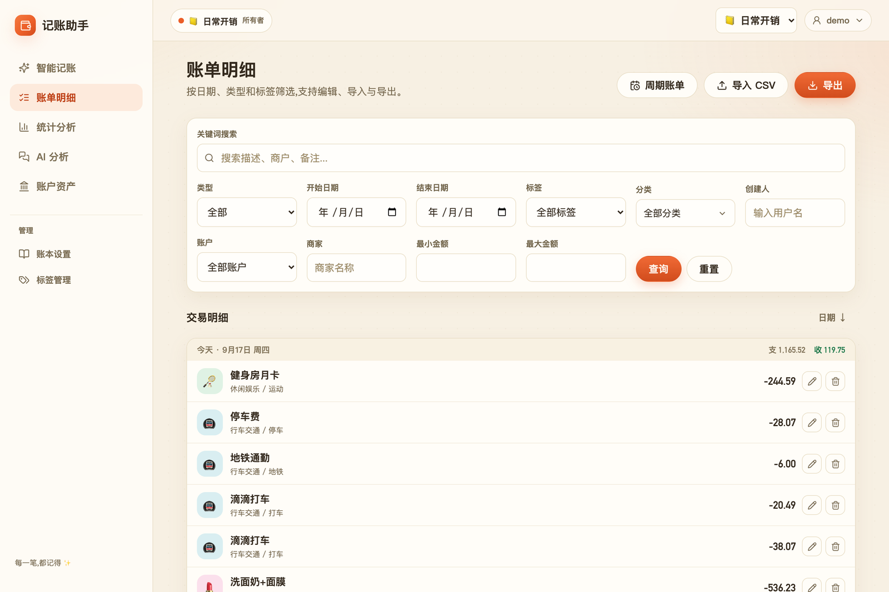 | 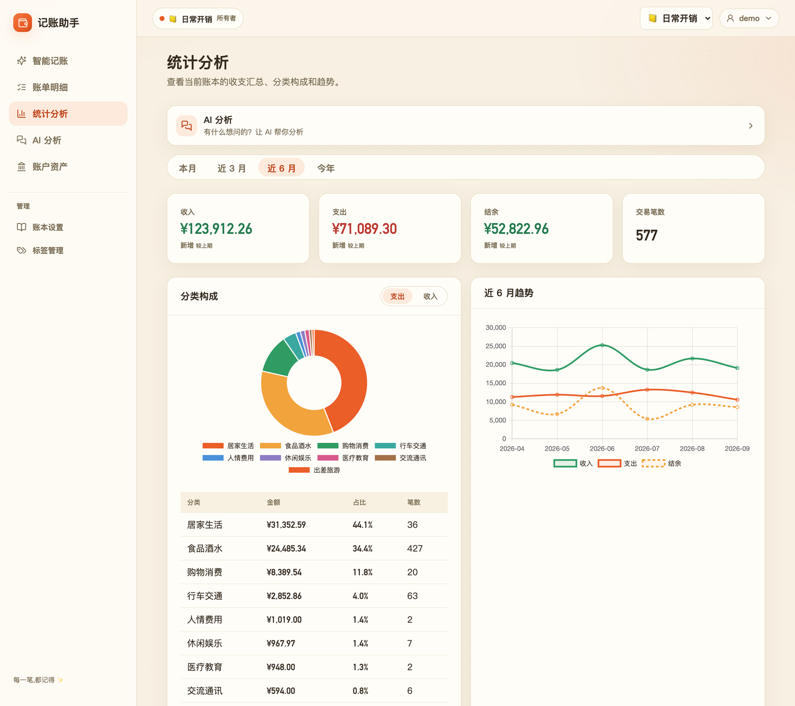 |
| **账户管理** | **账本管理** |
| 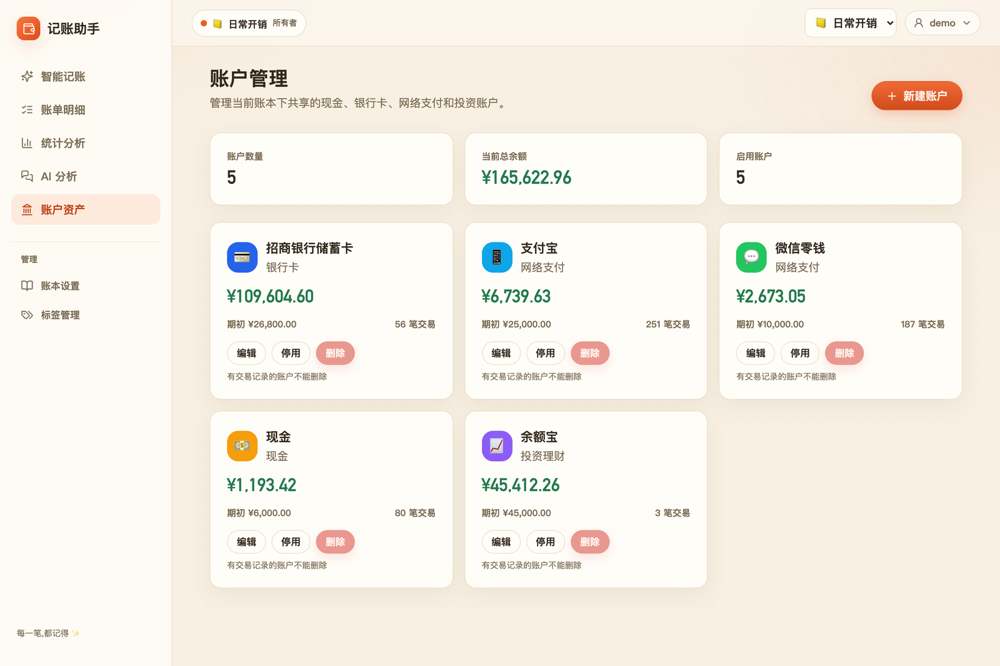 | 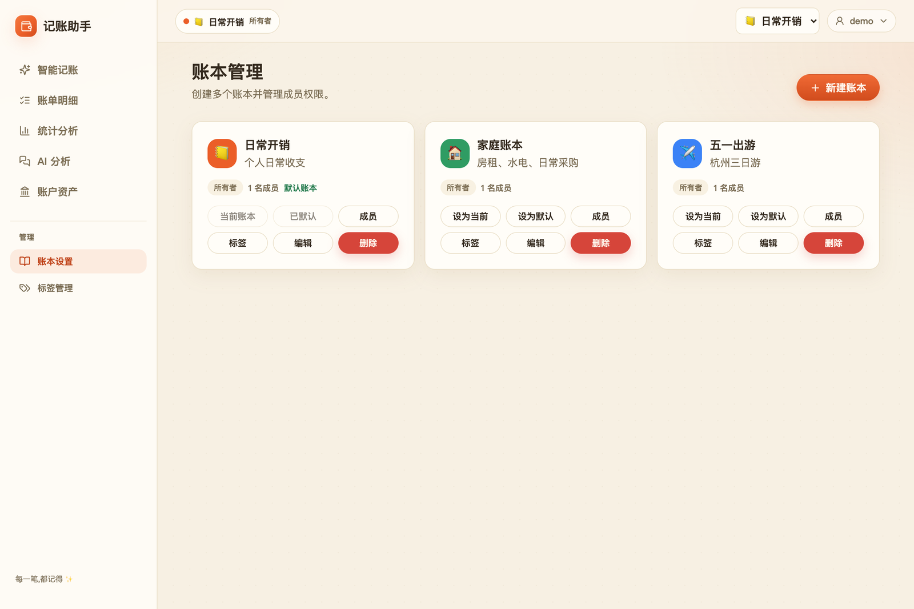 |

### 移动端

| 智能记账 | 账单明细 | 统计分析 | 我的 |
|:---:|:---:|:---:|:---:|
| 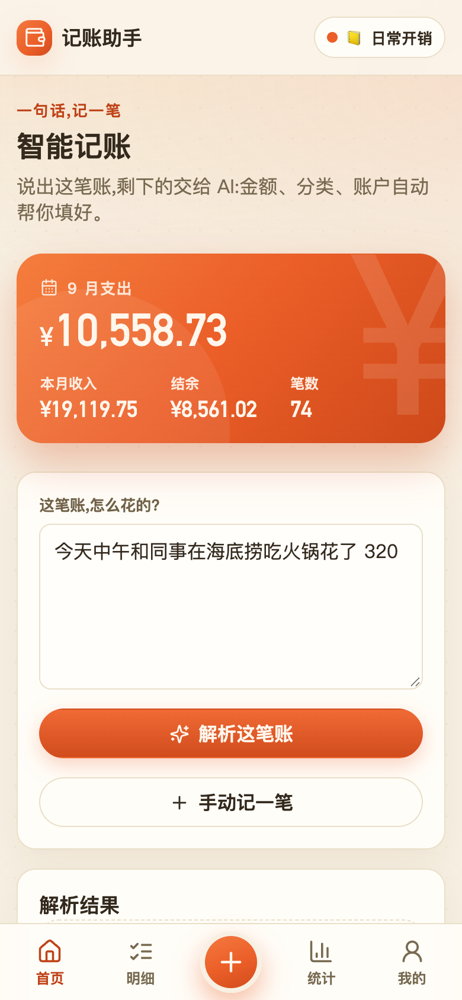 | 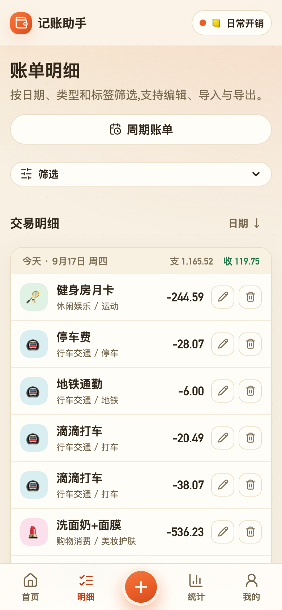 | 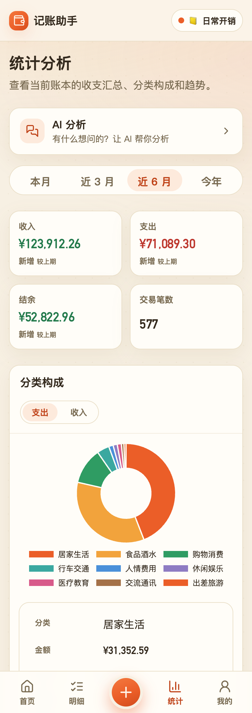 | 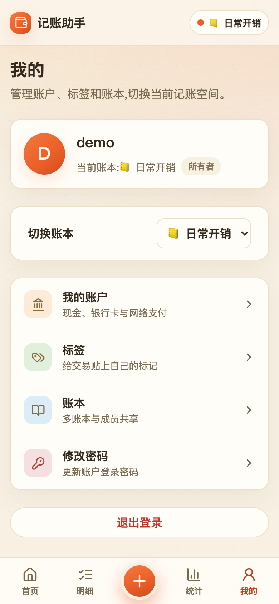 |
| **账户管理** | **账本管理** | **登录** | |
| 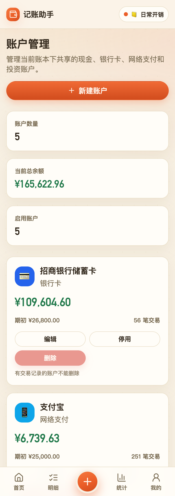 | 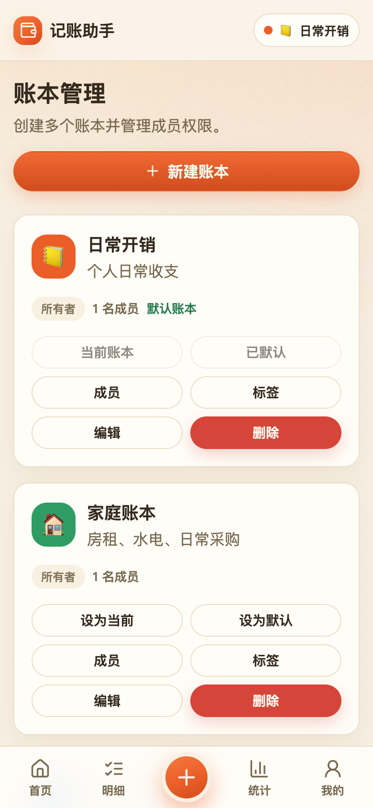 | 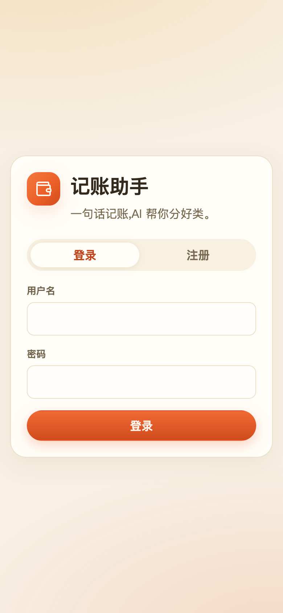 | |

## 技术栈

**后端：** Spring Boot 3.5.16 + Spring AI 1.1.8 + Spring Security + JPA + SQLite

**前端：** Vue 3 + TypeScript + Vite + Chart.js + Lucide Icons

**AI：** 支持 OpenAI 及兼容服务（如 Deepseek 等）

## 前置要求

- **Java 17+** - [下载 OpenJDK](https://adoptium.net/)
- **Maven 3.9+** - 或使用项目内的 `./mvnw`
- **Node.js 22+ / npm** - 仅本地构建前端时需要
- **AI API Key** - OpenAI API Key 或兼容服务的 API Key

## 快速开始

### 1. 克隆仓库

```bash
git clone https://github.com/liuqitoday/smart-accounting-assistant.git
cd smart-accounting-assistant
```

### 2. 配置 AI 服务

**本地运行**（`java -jar` 或 `./mvnw spring-boot:run`）：在**项目根目录**创建 `application-local.yml`（已被 `.gitignore` 忽略，不会提交）。Spring Boot 会自动加载该文件，**API Key 缺失时应用会启动失败**：

```yaml
spring:
  ai:
    openai:
      api-key: sk-your-api-key-here
      base-url: https://api.openai.com  # OpenAI 官方
      # base-url: https://api.deepseek.com  # Deepseek
      chat:
        options:
          model: gpt-3.5-turbo  # 或 gpt-4, deepseek-chat 等
```

> `.env` 文件**只被 `docker compose` 读取**，本地 `java -jar` / `spring-boot:run` 不会加载它；本地运行请用上面的 `application-local.yml`。

**Docker / Docker Compose 部署**：复制 `.env.example` 为 `.env` 并填写配置：

```bash
cp .env.example .env
```

**AI 服务选项：**

| 服务 | base-url | model 示例 | 备注 |
|------|----------|-----------|------|
| OpenAI | `https://api.openai.com` | `gpt-3.5-turbo`, `gpt-4` | 官方服务 |
| Deepseek | `https://api.deepseek.com` | `deepseek-chat` | 国内可用 |

### 可选：开启截图记账

截图记账默认关闭。确认当前服务和模型支持 OpenAI 兼容的图片输入（vision / `image_url`）后，再开启功能；它复用上面的 `spring.ai.openai` 下的 `base-url`、`api-key` 和 `chat.options.model`，无需另一套凭据。仅修改开关不会让文本模型具备图片识别能力，表中的文字模型示例也不代表支持图片。

本地运行时，在已有 `application-local.yml` 中增加：

```yaml
app:
  ai:
    multimodal-enabled: true
```

使用 Docker Compose 时，在 `.env` 中将 `SPRING_AI_OPENAI_MODEL` 设为服务商支持的图片模型名称，并设置 `AI_MULTIMODAL_ENABLED=true`，然后运行 `docker compose up -d --force-recreate`。直接运行 jar 或 Docker 容器时，也可以传入环境变量 `AI_MULTIMODAL_ENABLED=true`。更改配置后需要重启应用。

开启后，可从智能记账首页或移动端底部“＋”打开统一记账面板，选择“截图”；关闭时截图入口隐藏，后端也会拒绝图片识别请求。桌面端可以选择、拖入或粘贴截图，手机端可以从相册选择截图。

1. 上传一张 PNG 或 JPEG 截图，单张不超过 **5 MiB（5,242,880 字节）**、**2000 万像素**，最多识别 **20 笔**消费或收入。
2. 点击“识别这张截图”，查看原图和识别结果。应用会把图片发送给已配置的 AI 服务，应用本身不持久保存原图。
3. 逐笔核对金额、收支类型、日期、分类和账户，再点击“确认并记下这一笔”；也可跳过某笔。识别本身不会入账。

截图缺少完整日期时，需要补充日期后保存；分类会匹配现有分类及账本历史纠正记录。付款或收款账户仅在当前账本的启用账户中按名称唯一匹配，不确定时保留“未指定账户”，由用户选择。余额、多笔账单的统计合计、未支付订单、本人账户互转及明确的非人民币交易不作为可直接保存的截图交易。单笔已支付收据的实付合计可以作为交易金额，已有实付金额时不再扣减优惠；退款中不当作已到账收入。

识别结果草稿按账号和账本保存在本机。切换账本会取消原账本的识别请求并释放原图；刷新后需要重新选择原图才能对照。原始截图文件不写入本机缓存。

图片识别与文字解析共用 `app.ai.daily-limit` 配额（默认每用户每天 200 次，按上海时间跨日）。如经过 Nginx 等反向代理，请将请求体上限设为**至少 6 MiB**，为 multipart 上传边界预留空间。配置细节见[部署指南](docs/DEPLOYMENT.md#截图记账配置)，接口示例见[API 文档](docs/API.md#截图记账)。

### 文字解析与分析问数

- 文字入口每次核对一笔已发生的人民币收支。优先提取实际支付或到账金额，例如“原价 100、优惠 20、实付 80”应记 80；商户、人物和备注仅提取明确内容，分类 ID 必须来自实际分类树。
- 模型识别到多笔交易、本人账户互转、外币、未发生的交易或信息不足时，返回补充信息或切换入口的提示；这些结果不会再降级为规则猜测。正常模型结果也会校验金额、收支类型、日期和描述；模型输出格式或字段无效时返回明确错误。模型调用失败仍保留原有基础规则回退，前端会提示核对。
- 日期以 `Asia/Shanghai` 为准，分析请求使用同一个日期基准生成提示、校验计划和执行查询。“平均每笔”使用交易均值，“平均每月”按月份聚合后计算期间平均；净结余按收入减支出计算。
- 分析追问只继承最近成功分析中未被新问题修改的条件。无法确定账户、分类、标签或时间时先澄清，不通过丢掉筛选条件来扩大查询范围。模型只生成结构化计划，查询、金额计算和最终数字回复仍由服务端完成。
- 固定规则放在 system 消息，原文、候选项和对话记录作为 JSON 数据传入。文字抽取与分类仍共用一次模型调用，分析也没有新增模型调用。

### 3. 构建并运行

```bash
# 完整构建（包含前端）
./mvnw clean package

# 运行
java -jar target/accounting-assistant-0.0.1-SNAPSHOT.jar
```

浏览器打开 `http://localhost:8081`，注册账号即可使用。

### 4. 本地开发（前后端分离）

```bash
# 终端 1：后端（跳过前端构建，加速启动）
./mvnw -Dskip.frontend=true spring-boot:run

# 终端 2：前端 Vite 开发服务器
cd frontend
npm install
npm run dev
```

前端监听 `http://localhost:5173`，API 请求自动代理到后端 `8081` 端口。

### 手机安装、草稿与离线使用

在 HTTPS 站点的“我的 → 添加到桌面”安装。Android 支持的浏览器会显示安装提示；iPhone 可通过 Safari 分享菜单选择“添加到主屏幕”。PWA 的离线能力需要先在线打开生产构建，开发服务器不启用 Service Worker。

- 底部“＋”在当前页面打开统一记账面板。关闭面板或切换 Tab 会保留输入；文字和截图解析可以在面板关闭后继续，文字解析也可主动取消。
- 记账弹框采用两列核心字段和吸底保存栏，长分类和描述占整行。文字解析成功后收起原文，点击“修改”可以重新编辑；原文变化时提示重新解析，重新解析期间暂时禁用结果编辑和保存。
- 文字、手动、截图识别结果和 AI 分析问题草稿按账号、账本隔离，最多保留 30 天；原始截图文件不写入本机缓存。主动退出登录或登录失效会清除该账号的草稿与查询快照。
- 已访问数据保留有限的最近快照，最多 7 天。断网时显示提示并可继续查看已缓存内容；首次未加载的数据仍需联网。
- 普通收入、支出在断网时可“保存，联网后同步”。待同步账目先持久化到本机，恢复网络且登录有效时提交到原账本。请求标识使超时重试、丢失响应后的重发不会重复入账；标签与账目一起保存。
- 待同步队列最多 100 笔，可查看错误、重试或移除失败条目。退出登录不会删除待同步账目，原账号再次登录后才继续同步；清除浏览器站点数据会删除本机草稿和待同步内容。
- AI 识别与分析、转账、编辑已有账目需要联网。应用关闭期间不保证后台同步，重新打开或回到应用时会重新检查连接。
- 新版本准备好后显示更新提示；弹窗开启或保存、解析等操作进行中会暂缓更新，持久化草稿在更新后恢复。

## 部署

### Docker 部署（推荐）

1. **使用预构建镜像（最省事）**

打 `v*` tag 时 CI 会自动构建 `linux/amd64` + `linux/arm64` 多架构镜像并推送到两个 registry，直接拉取即可（无需本地构建）：

```bash
# GitHub Container Registry
docker pull ghcr.io/liuqitoday/smart-accounting-assistant:latest

# Docker Hub
docker pull liuqitoday/smart-accounting-assistant:latest
```

运行（镜像地址换成上面任一）：

```bash
docker run -d --name accounting-assistant \
  -p 8081:8081 \
  -v $(pwd)/data:/app/data \
  -e SPRING_AI_OPENAI_API_KEY=sk-your-key \
  -e REMEMBER_ME_KEY=$(openssl rand -hex 32) \
  ghcr.io/liuqitoday/smart-accounting-assistant:latest
```

2. **使用 Docker Compose**

```bash
# 创建配置文件
cp .env.example .env
# 编辑 .env 填入你的 API Key

# 启动服务（会基于本地源码构建镜像）
docker compose up -d

# 查看日志
docker compose logs -f

# 停止服务
docker compose down
```

访问 `http://localhost:8081`

3. **手动构建镜像**

```bash
# 构建镜像
docker build -t accounting-assistant .

# 运行容器
docker run -d \
  --name accounting-assistant \
  -p 8081:8081 \
  -v $(pwd)/data:/app/data \
  -e SPRING_AI_OPENAI_API_KEY=sk-your-key \
  -e REMEMBER_ME_KEY=$(openssl rand -hex 32) \
  accounting-assistant
```

**内存调优（可选）：** 容器内直接通过 JVM 原生的 `JAVA_TOOL_OPTIONS` 传入参数，例如 `-e JAVA_TOOL_OPTIONS="-Xmx512m -Xms256m"`（`JAVA_OPTS` 仅 systemd 部署使用）。

### 传统部署

**systemd 服务（Linux）**

1. 创建 jar 包：

```bash
./mvnw clean package
```

2. 创建服务文件 `/etc/systemd/system/accounting-assistant.service`：

```ini
[Unit]
Description=Accounting Assistant
After=network.target

[Service]
Type=simple
User=your-user
WorkingDirectory=/opt/accounting-assistant
Environment="SPRING_AI_OPENAI_API_KEY=sk-your-key"
Environment="REMEMBER_ME_KEY=change-me-random-hex"
Environment="COOKIE_SECURE=true"
ExecStart=/usr/bin/java -jar /opt/accounting-assistant/accounting-assistant-0.0.1-SNAPSHOT.jar
Restart=on-failure
RestartSec=10

[Install]
WantedBy=multi-user.target
```

3. 启动服务：

```bash
sudo systemctl daemon-reload
sudo systemctl enable accounting-assistant
sudo systemctl start accounting-assistant
```

### HTTPS 配置

如果使用 Nginx 反向代理终止 SSL：

```nginx
server {
    listen 443 ssl http2;
    server_name your-domain.com;

    ssl_certificate /path/to/cert.pem;
    ssl_certificate_key /path/to/key.pem;

    # 截图文件最多 5 MiB，为 multipart 上传边界预留空间
    client_max_body_size 6M;

    location / {
        proxy_pass http://localhost:8081;
        proxy_set_header Host $host;
        proxy_set_header X-Real-IP $remote_addr;
        proxy_set_header X-Forwarded-For $proxy_add_x_forwarded_for;
        proxy_set_header X-Forwarded-Proto $scheme;
    }
}
```

并设置环境变量：

```bash
export COOKIE_SECURE=true
```

## 环境变量

| 变量名 | 说明 | 默认值 | 必需 |
|--------|------|--------|------|
| `SPRING_AI_OPENAI_API_KEY` | AI 服务 API Key | 无 | 是 |
| `SPRING_AI_OPENAI_BASE_URL` | AI 服务 Base URL | `https://api.openai.com` | 否 |
| `SPRING_AI_OPENAI_MODEL` | AI 模型名称 | `gpt-3.5-turbo` | 否 |
| `AI_MULTIMODAL_ENABLED` | 开启截图记账；要求当前服务和模型支持图片输入，复用现有 AI 配置 | `false` | 否 |
| `REMEMBER_ME_KEY` | Remember-me 令牌签名密钥，生产环境务必设为随机值（`openssl rand -hex 32`） | 内置固定值（不安全，仅供本地） | 生产必填 |
| `COOKIE_SECURE` | 启用 HTTPS Secure Cookie | `false` | 否 |
| `SERVER_PORT` | 服务端口 | `8081` | 否 |
| `SPRING_DATASOURCE_URL` | 数据库路径 | `jdbc:sqlite:accounting-assistant.db?journal_mode=WAL&busy_timeout=5000&synchronous=NORMAL` | 否 |

## 文档

- [API 文档](docs/API.md) - 常用接口与统一响应格式
- [部署指南](docs/DEPLOYMENT.md) - Docker / systemd / 反向代理 / 备份
- [贡献指南](docs/CONTRIBUTING.md) - 开发环境、代码规范、PR 流程
- [交易筛选、导出与导入指南](docs/FILTER_AND_EXPORT_GUIDE.md)
- [标签与 CSV 导入指南](docs/TAG_AND_IMPORT_GUIDE.md)

## 数据库

使用 SQLite 文件数据库 `accounting-assistant.db`，应用启动时自动创建表和初始化数据。

**备份：**

```bash
# 备份
cp accounting-assistant.db accounting-assistant-$(date +%Y%m%d).db

# 恢复（先停应用）
cp accounting-assistant-20260116.db accounting-assistant.db
```

**查看数据：**

```bash
sqlite3 accounting-assistant.db ".tables"
sqlite3 accounting-assistant.db "SELECT * FROM transactions LIMIT 10;"
```

**核心表：**

- `users` - 用户
- `ledgers` - 账本
- `ledger_members` - 账本成员
- `transactions` - 交易记录
- `categories` - 分类
- `accounts` - 账户
- `tags` - 标签

## 项目结构

```text
smart-accounting-assistant/
├── frontend/                      # Vue 3 前端
│   ├── src/
│   │   ├── api/                   # HTTP 封装 + API 函数
│   │   ├── components/            # 通用组件
│   │   ├── stores/                # 状态管理（reactive 单例）
│   │   ├── utils/                 # 工具函数
│   │   └── views/                 # 页面视图
│   ├── public/                    # 静态资源
│   └── vite.config.ts
├── src/main/java/
│   └── com/liuqitech/accountingassistant/
│       ├── config/                # 配置类
│       ├── controller/            # REST 控制器
│       ├── dto/                   # 请求/响应 DTO
│       ├── entity/                # JPA 实体
│       ├── enums/                 # 枚举
│       ├── exception/             # 全局异常处理
│       ├── interceptor/           # 拦截器（账本上下文）
│       ├── repository/            # JPA Repository
│       ├── security/              # Spring Security 配置
│       ├── service/               # 业务逻辑 + AI 解析
│       └── util/                  # 工具类
├── src/main/resources/
│   ├── application.yml            # 主配置
│   ├── data.sql                   # 初始化数据
│   └── logback-spring.xml         # 日志配置
├── docs/                          # 文档（API/部署/贡献/功能指南）
│   └── images/                    # README 界面截图
├── .env.example                   # 环境变量示例
├── docker-compose.yml
├── Dockerfile
├── LICENSE                        # MIT 协议
├── pom.xml
└── README.md
```

## 常见问题

**Q: 启动后前端页面 404？**

A: 需要先完整构建（`mvn clean package`）或本地开发时启动前端 Vite 服务器。

**Q: SQLite 报 database is locked？**

A: 确认只有一个应用实例在写入。可执行：

```bash
sqlite3 accounting-assistant.db "PRAGMA journal_mode=WAL;"
```

**Q: AI 解析失败？**

A: 检查：
1. API Key 是否正确配置
2. Base URL 是否可访问
3. 模型名称是否正确
4. 查看日志 `account-assistant-logs/application.log` 或控制台输出

**Q: 如何切换 AI 服务商？**

A: 修改 `application-local.yml` 或环境变量：

```yaml
spring:
  ai:
    openai:
      api-key: your-new-key
      base-url: https://new-provider.com
      chat:
        options:
          model: new-model-name
```

**Q: 为什么没有“截图记账”入口，或开启后识别失败？**

A: 默认不显示入口。先确认模型和代理支持图片输入，再设置 `AI_MULTIMODAL_ENABLED=true`（本地 YAML 对应 `app.ai.multimodal-enabled: true`）并重启。Compose 的 `.env` 更改后需重建容器配置。若仍失败，检查文件是否为完整 PNG/JPEG、是否超过 5 MiB / 2000 万像素、反向代理是否允许至少 6 MiB 请求，以及当前模型的图片能力和调用配额。模型不可用时会提示重试，不会凭空生成交易。

**Q: 如何备份数据？**

A: 直接复制 `accounting-assistant.db` 文件即可。Docker 部署时数据在 `./data/` 目录。

## 贡献

欢迎贡献代码、报告 Bug、提出新功能建议！

1. Fork 本仓库
2. 创建特性分支 (`git checkout -b feature/AmazingFeature`)
3. 提交更改 (`git commit -m 'Add some AmazingFeature'`)
4. 推送到分支 (`git push origin feature/AmazingFeature`)
5. 开启 Pull Request

详见 [docs/CONTRIBUTING.md](docs/CONTRIBUTING.md)

## 开源协议

本项目采用 [MIT License](LICENSE) 开源协议。

## 致谢

- [Spring Boot](https://spring.io/projects/spring-boot)
- [Spring AI](https://spring.io/projects/spring-ai)
- [Vue.js](https://vuejs.org/)
- [Chart.js](https://www.chartjs.org/)
- [Lucide Icons](https://lucide.dev/)

## 联系方式

- 问题反馈：[GitHub Issues](https://github.com/liuqitoday/smart-accounting-assistant/issues)
- 功能建议：[GitHub Discussions](https://github.com/liuqitoday/smart-accounting-assistant/discussions)

---

如果这个项目对你有帮助，欢迎 Star 支持！
