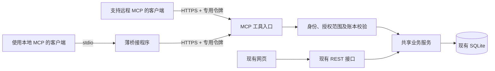

本文是记账服务接入 MCP 的原始设计草案，编写于 2026-11-20。第一阶段已实现，当前配置、工具契约、限制与验证方式以 [MCP 接入指南](MCP.md) 为准；本文保留后续 OAuth 及扩展能力的设计方向。

产品定位是通用的「记账 MCP 服务」，面向支持 MCP 的各类 Agent、桌面客户端和用户自建程序。推荐在现有 Spring Boot 应用内提供远程 MCP 服务，地址为 `https://记账服务域名/mcp`。Agent 理解用户意图后调用工具，记账服务负责身份认证、账本权限、字段校验、入账和统计。所有入口使用同一套账目及业务规则，工具不绑定任何客户端的名称、会话机制或私有 API。

第一阶段完成个人用户的「连接 Agent → 记账 → 查账 → 撤销连接」闭环，提供 Streamable HTTP 主入口，以及面向只支持本地进程启动的客户端的 stdio 薄桥接。先使用可撤销的专用令牌，随后增加 OAuth 授权。MCP 协议是通用的，但客户端支持的传输、授权方式和协议版本存在差异，接入文档应明确这些维度，而不是承诺一份配置通用于所有客户端。

目标使用体验如下：

1. 用户在网页「我的 → MCP 连接」中创建一个连接，例如「个人助手」或「工作电脑」。
2. 选择可访问账本、默认账本、操作权限和有效期，获得 MCP 地址及专用令牌。
3. 将服务加入所选 Agent 的 MCP 配置，完成工具发现与连通性检查。
4. 对 Agent 说「今天午饭花了 35 元，用微信付的，记到生活账本」。Agent 确认账本、分类和账户后提交，回复实际保存的日期、金额、账户、分类和记录 ID。
5. 对 Agent 说「这个月餐饮花了多少」「看看上周超过 100 元的支出」，获取服务端查询结果。
6. 用户可以随时在网页查看最近调用和撤销连接。

对于明确的记账指令且必要字段齐全，允许直接保存；信息不足或存在多个可能的账本、账户时先追问。客户端自身的工具审批策略仍然生效。单纯提到一笔消费、讨论预算或粘贴一张账单，不自动代表要求写入。



当前代码已经提供以下可复用基础：

| 现有能力 | 代码位置 | MCP 中的用途 |
| --- | --- | --- |
| 用户登录、Session、Remember-me、CSRF | `config/SecurityConfig.java` | 继续承载网页里的连接管理 |
| 账本成员及 OWNER / EDITOR / VIEWER 角色 | `service/LedgerAccessService.java` | 每次工具调用检查用户当前权限 |
| 保存请求去重及持久化回执 | `service/TransactionSaveService.java` | 防止超时、重发或并发重试导致重复入账 |
| 交易查询、详情、创建 | `service/TransactionService.java` | 复用账目模型、分类快照、账户和标签关联 |
| 结构化分析校验与执行 | `service/analysis/AnalysisPlanValidator.java`、`AnalysisReadService.java`、`AnalysisOperationExecutor.java` | 复用精确计算、筛选及统计口径 |
| 账户选项与分类、标签 | `service/AccountService.java`、`CategoryService.java`、`TagService.java` | 为 Agent 提供可选 ID 和名称 |
| 业务时间 | `util/AppClock.java` | 统一使用 Asia/Shanghai |

上表中的 Java 路径相对于 `src/main/java/com/liuqitech/accountingassistant/`。尤其需要注意：去重封装在 `TransactionSaveService.save` 中，直接调用 `TransactionService.saveTransaction` 或 `createTransaction` 不会自动获得该保证。

第一版建议固定提供六个工具。工具名、参数和返回结构稳定，工具描述写清适用场景；用户身份一律从认证上下文取得。

| 工具 | 用途 | 主要输入 | 主要输出 | 所需 scope |
| --- | --- | --- | --- | --- |
| `accounting_get_context` | 了解当前连接可用范围 | 无 | 服务端日期、时区、币种、授权账本、默认账本、各账本有效权限 | `reference:read` |
| `accounting_get_ledger_options` | 获取记账及筛选候选项 | `ledgerId` | 分类树、账户选项、标签及默认账户提示 | `reference:read` |
| `accounting_create_transaction` | 保存一笔普通收入或支出 | `ledgerId`、金额、类型、日期、分类、描述、`clientRequestId`，可选账户和标签 | 保存回执、账目 ID 及规范化结果 | `transactions:create` |
| `accounting_list_transactions` | 筛选账单明细 | `ledgerId`、日期范围、类型、分类、账户、标签、商户、关键词、金额范围、分页 | 当前页、总笔数、页码、是否还有下一页、实际筛选条件 | `transactions:read` |
| `accounting_get_transaction` | 查看指定账目 | `ledgerId`、`transactionId` | 账目详情 | `transactions:read` |
| `accounting_get_statistics` | 查汇总、分类分布及趋势 | `ledgerId`、日期范围、`mode` 及筛选条件 | 服务端计算的金额、笔数、分组或趋势数据及统计范围 | `statistics:read` |

`reference:read` 只包含授权账本和记账选项，不包含账户余额或账单内容。创建权限需要有选择分类和账户的能力，因此自动附带这个 scope。只读工具标注 `readOnlyHint=true`；创建工具在要求稳定去重标识的前提下标注 `idempotentHint=true`。这些协议注解用于帮助客户端理解行为，实际权限由服务端执行。

`accounting_get_context` 返回令牌配置的默认账本；该账本必须仍在授权范围内且用户仍有成员权限。默认账本只是一项提示，后续所有账本操作仍须显式传 `ledgerId`。多个授权账本且未设置默认值时，由 Agent 追问。网页切换当前账本不会改变正在进行的 Agent 操作目标。

`accounting_get_ledger_options` 返回真实的分类 ID、名称和层级，以及账户、标签 ID。账户包含启用状态和默认账户提示，创建操作只接受当前账本的启用账户。标签允许账本标签及现有规则允许的系统标签。候选项可短期缓存，但写入时再次校验，防止使用过期选项。

Agent 根据候选项选择分类；不确定时先澄清，或在分类树实际提供且适用时使用「其他」。用户未指定账户时，第一版保存为「未指定账户」；如果未来提供「未指定时使用默认账户」偏好，应由用户在连接设置中显式开启，并在保存回执中体现。用户指定「微信」但当前账本没有对应启用账户时返回澄清需求，不能静默忽略。

创建工具的输入示例（以下 ID 均为示意）：

```json
{
  "ledgerId": 1,
  "type": "EXPENSE",
  "amount": "35.00",
  "currency": "CNY",
  "transactionDate": "2026-11-20",
  "description": "午饭",
  "categoryId": 12,
  "accountId": 3,
  "tagIds": [],
  "originalText": "今天午饭花了35元，用微信付的，记到生活账本",
  "clientRequestId": "0ac198ce-b2b1-4cd9-9bc7-bf2f4dbaf02e"
}
```

金额使用十进制字符串，服务端转换为 BigDecimal，要求大于零、最多两位小数且符合现有字段精度；多余精度直接报错，不静默四舍五入。第一版币种固定为 `CNY`，仅接受 `INCOME` 和 `EXPENSE`。日期使用 `YYYY-MM-DD`，由 Agent 根据上下文返回的上海日期解析「今天」「昨天」，服务端做严格校验。日期不明时先澄清，不把未知日期自动当成今天。

`categoryId` 必填，服务端校验分类和收支类型匹配。`description` 必填并限制长度；`originalText` 可选，仅携带触发此次记账的原话，省略时映射为 description 以兼容现有保存模型。`merchant`、`note`、`relatedUser` 为可选字段，统一进行长度限制。账户与标签必须通过当前账本规则校验。`createdBy`、连接来源及模型来源信息由服务端设置，不接受 Agent 自报身份或伪造系统分类纠正记录。

下例是成功返回的 `structuredContent` 结构；实际 MCP 返回还包括对应的文本 JSON 内容，兼容只读取 `content` 的客户端：

```json
{
  "ok": true,
  "data": {
    "transactionId": 2468,
    "ledgerId": 1,
    "ledgerName": "生活账本",
    "type": "EXPENSE",
    "amount": "35.00",
    "currency": "CNY",
    "transactionDate": "2026-11-20",
    "description": "午饭",
    "categoryName": "餐饮",
    "accountName": "微信",
    "clientRequestId": "0ac198ce-b2b1-4cd9-9bc7-bf2f4dbaf02e"
  }
}
```

该结果是创建时的保存回执。重试返回原回执；如果这笔账后来在网页被修改或删除，以详情查询中的最新状态为准。调用超时不能被 Agent 表述为「没有保存」，应以原参数和原 `clientRequestId` 重试确认。

每个新写入意图必须生成并保留稳定的 UUID。同一用户、账本、UUID 和相同内容重复提交时只保存一次；同 UUID 对应不同内容时返回 `IDEMPOTENCY_CONFLICT`。不能把 MCP JSON-RPC 请求 ID 当成业务去重 ID，也不能在每次重试时重新生成 UUID。该机制防止同一请求重发；对重新生成 UUID 的第二次消费描述并不承诺自动识别为重复。

账单列表按 `transactionDate DESC, id DESC` 排序，页码从 0 开始，默认每页 20 条，上限 100 条。日期必须明确提供，`startDate` 和 `endDate` 均包含边界；Agent 可以把「最近账单」解释为最近 30 天并在回答中说明范围。返回 `items`、`page`、`pageSize`、`totalElements`、`hasMore` 和 `appliedFilters`。不将第一页当成全部结果，也不通过拉取有限页数后自行相加回答总金额。第一版使用现有分页能力，分页期间若发生写入，重新查询可能改变页内容，不提供导出快照语义。

统计工具的 `mode` 限定为 `summary`、`by_category`、`trend`，趋势粒度限定为 `day` 或 `month`。第一版统一支持日期、收支类型、分类、账户、标签、商户、关键词和金额范围筛选；参数映射到现有结构化分析模型后，先经过校验器再执行。只有有效筛选项才执行；不支持或无效的条件必须报错，不能丢弃条件后扩大范围。统计排除软删除记录和账户内部转账，结果携带完整日期、币种和筛选条件，金额由服务端计算。

普通查账和记账不额外调用记账服务自己的大模型：外部 Agent 已有语言理解能力，MCP 主要提供确定性的业务操作。现有文字解析、截图解析和复杂自然语言分析可作为后续可选工具，沿用各自配额和校验，并通过独立 scope 控制。外部 Agent 的一轮对话不应无意中写入网页的分析聊天历史。

业务错误使用 MCP 工具错误结果 `isError=true`，在内容中给出稳定的 `errorCode`、用户可读 message、可选字段错误、`retryable` 和操作建议。缺失字段、候选项歧义、权限不足和重复请求冲突应有不同错误码；查询无数据是正常空结果。无令牌、令牌过期或撤销在 HTTP 层返回 401；工具内授权失败返回明确的权限错误。协议格式错误交由 SDK 处理。数据库不可用等错误不能变成空账单或零金额，也不返回 SQL、堆栈或其他账本的数据。

连接授权采用「一名用户、一个 Agent、一份授权」。令牌是记账服务签发的专用个人访问令牌，与网页密码和大模型 API Key 无关。创建时提供两种常用权限组合：

| 权限组合 | 包含的 scope | 典型用途 |
| --- | --- | --- |
| 只读查询 | `reference:read`、`transactions:read`、`statistics:read` | 查看账单和统计 |
| 记账与查询 | 上述 scope 加 `transactions:create` | 日常记账助手 |

账本授权必须显式选择，不默认覆盖以后新建或新加入的账本。令牌权限是上限，有效权限为「令牌 scope ∩ 令牌账本范围 ∩ 用户当前成员权限」：VIEWER 即使持有创建 scope 也不能写账；用户被移出账本或降权，后续调用立即按新权限处理。查询指定账目时同时检查账本范围和账目所属账本，不依赖 transactionId 的不可猜测性。

令牌使用密码学安全随机数生成（至少 256 位熵），服务端仅存摘要、展示前缀及元数据，完整令牌只显示一次。建议提供 30 / 90 / 365 天有效期，默认 90 天；支持撤销及轮换。每个请求重新检查有效性，撤销后新请求立即失败；已授权且正在执行的请求可能已经提交，其结果可在调用记录中追踪。令牌仅放在 `Authorization: Bearer ...`，不进入 URL、Prompt 或日志。密码修改流程应同步撤销该用户的 Agent 令牌，并在页面说明其影响。

连接管理页面展示连接名称、授权账本、权限、创建时间、有效期、最后使用时间、状态以及最近调用。创建流程结束后提供服务地址、完整令牌的一次性展示和按客户端生成的配置片段；回到列表后仅展示掩码，找回能力通过重新生成实现。网页管理接口继续使用登录态和 CSRF：建议新增 `GET/POST /api/mcp/connections`、`POST /api/mcp/connections/{id}/revoke`、`POST /api/mcp/connections/{id}/rotate` 和 `GET /api/mcp/connections/{id}/calls`。这些接口只允许操作当前用户的连接，不能使用 MCP 令牌管理连接。

固定令牌标识的是连接所属的记账用户。如果一个 Agent 被多名聊天用户共同使用，他们经同一连接发出的请求也共享这份授权。第一版定位个人自用；对外提供多人机器人时，需要增加每个用户独立的授权和身份映射。工具参数中传入 `userId` 不能替代用户认证。

在技术实现上，优先使用现有 Spring AI 1.1.8 依赖管理下的 `spring-ai-starter-mcp-server-webmvc`，采用 Stateless Streamable HTTP（`spring.ai.mcp.server.protocol=STATELESS`），工具同步调用现有服务。当前需求无需服务端向客户端请求 sampling、elicitation 或维持资源订阅。是否符合目标客户端的握手及协议版本要求，必须通过联调确认。

这里的 `STATELESS` 是 Spring AI 的服务模式；是否保存会话状态与支持哪一版 MCP 协议是两个问题。先依据当前 BOM 实际解析的 Java SDK 版本明确支持的协议修订，测试客户端与服务端的共同版本；若某目标客户端要求 SDK 尚未支持的协议修订，再将依赖升级或兼容适配列为单独工作。网页统计及记账逻辑不依赖协议修订。

拟议的模块分工如下，新增内容统一位于 `mcp` 包及少量现有入口改动中：

| 组件 | 职责 |
| --- | --- |
| `McpSecurityConfig`、`McpTokenAuthenticationFilter` | 保护 `/mcp`，验证 Bearer 令牌 |
| `McpCallerContext` | 携带认证产生的用户、连接、scope，不来自工具参数 |
| `McpAuthorizationService` | 每次操作校验 scope、账本授权和当前角色 |
| `AccountingMcpTools` | 固定六个工具的 schema、描述、输入输出及错误映射 |
| `McpAccountingFacade` | 参数校验、DTO 映射及调用共享业务服务 |
| `McpConnectionService`、网页 Controller | 创建、列出、撤销、轮换连接和查看调用记录 |
| 前端连接页面 | 授权向导、配置片段、状态和记录 |

`/mcp` 必须有优先匹配的独立 SecurityFilterChain，仅接受 Bearer，不通过 Cookie 认证，也不创建网页 Session。CSRF 豁免仅针对这个独立入口；连接管理 API 仍需 CSRF。现有 SecurityConfig 的兜底规则是 `anyRequest().permitAll()`，因此添加 MCP starter 的同时必须补齐入口保护，避免新端点落到公开规则中。有效 Origin 存在时按受信任域名验证，并设置允许的 Host 和请求大小；面向公网使用 HTTPS。

现有账本拦截器只覆盖指定的 REST 路径，并部分依据 HTTP 方法判断读写；MCP 的读、写工具都可能由 HTTP POST 承载，因此新工具不能依靠该拦截器鉴权。通过 Facade 显式调用 `LedgerAccessService.requireAccess`，在身份与授权校验后才能进入业务服务或读取去重回执。传输层认证上下文必须可靠传递至工具执行；不能假定跨线程的 SDK 回调自动继承 Servlet 请求或 SecurityContext 的 ThreadLocal。

保存工具复用 `TransactionSaveService` 的去重事务，增加独立 MCP DTO 校验及来源映射。HTTP Controller 上的 `@Valid` 不会自动保护直接调用 Service 的路径，所以金额、类型、日期和引用对象等校验必须在 MCP 调用链执行。若补充共用校验，应放到应用服务以供两种入口复用。

建议新增三张表：

| 表 | 关键字段及约束 |
| --- | --- |
| `mcp_connections` | id、user_id、name、token_hash、token_prefix、scopes、default_ledger_id、created_at、expires_at、revoked_at、last_used_at；token_hash 唯一 |
| `mcp_connection_ledgers` | connection_id、ledger_id；组合唯一，授权变更时检查用户当前成员身份 |
| `mcp_call_logs` | connection_id、user_id、ledger_id、tool_name、request_id、transaction_id、outcome、error_code、created_at、duration_ms |

继续复用 `transaction_save_receipts`，不另造一套去重表。写入成功的来源记录应与账目及保存回执在同一事务中持久化，确保响应丢失时仍能追踪是哪一个连接创建了哪一笔；重试可记录调用但不会重新生成账目或覆盖原来源。普通调用日志不保存完整令牌、完整账单结果或原始对话，读取和失败日志保留期建议为 90 天；账目创建来源需要随账目长期保留，可在调用日志中对该类记录采用不同保留策略。

SQLite 的新增表和唯一约束沿用项目的初始化机制，必要的权限及去重结构创建失败时应中止启动。限制每个令牌及用户的调用频率、并发数、输入长度和结果大小；超限明确返回可重试信息，避免 Agent 的循环调用拖慢网页记账。额度数值在实现联调时按实际负载确定。

通用接入页面首先提供以下信息，并允许选择客户端生成对应的配置示例。客户端模板只是使用便利性功能，不参与服务端业务判断。

| 项目 | 建议值或行为 |
| --- | --- |
| 服务名称 | `accounting`，用户可自行修改 |
| 远程地址 | `https://accounting.example.com/mcp` |
| 远程传输 | Streamable HTTP |
| 第一阶段授权 | `Authorization: Bearer <专用令牌>` |
| 本地启动方式 | stdio 桥接进程，通过环境变量读取远程地址和专用令牌 |
| 工具发现 | 客户端完成 MCP 初始化后通过 `tools/list` 获取 |
| 工具调用 | 客户端通过 `tools/call` 调用，无需安装特定厂商 Skill |

stdio 桥接只负责协议、认证头和连接转换，所有业务仍在远程服务执行，避免在不同 Agent 上维护多套记账逻辑。凭据从进程环境或客户端密钥机制读取，日志写入 stderr，stdout 仅承载 MCP 消息。桥接应转发结构化结果、错误和取消；写入重连重试保留原业务 UUID。是否自行提供小型桥接程序或采用现有组件，由实际客户端兼容性测试决定。

第一版以 Tools 为必需能力。Resources、Prompts 可以后续作为辅助说明，但发现账本、获取候选项和执行操作不能依赖客户端具备这些可选界面，也不要求客户端支持 sampling、elicitation 或特定聊天平台的消息结构。

OpenClaw 只是客户端配置示例之一。其配置需要按目标版本核对 `mcp.servers`、`streamable-http`、请求头和环境变量的支持情况。以下片段展示预期接入形态，属于拟议示例，未在本仓库运行验证：

```json
{
  "mcp": {
    "servers": {
      "accounting": {
        "url": "https://accounting.example.com/mcp",
        "transport": "streamable-http",
        "headers": {
          "Authorization": "Bearer ${ACCOUNTING_MCP_TOKEN}"
        }
      }
    }
  }
}
```

在这个示例中，`ACCOUNTING_MCP_TOKEN` 需要在运行 OpenClaw 的环境中设置，并检查其工具策略是否允许调用。其他客户端应生成各自的配置结构，不能把上述 JSON 当作 MCP 统一配置格式。服务在另一台机器时必须使用 Agent 可访问的域名，localhost 指向的是 Agent 自己所在的运行环境。

第一阶段的 Bearer 令牌是支持手工配置凭据的接入方式，不等同于完整 MCP OAuth 授权发现。第二阶段面向需要浏览器授权的客户端，增加符合 MCP 授权规范的 OAuth 2.1 流程、PKCE、Protected Resource Metadata、授权服务器发现、资源 / audience 校验及令牌生命周期。复用已有的 scope 和账本授权模型，避免迁移业务工具契约。

后续功能按以下优先级扩展：

| 阶段 | 交付范围 | 完成标准 |
| --- | --- | --- |
| 第一阶段 | 六个工具、连接管理、令牌权限、审计、远程入口、stdio 桥接及通用接入指南 | 独立用户可在不同类型客户端走完记账与查账，并可立即撤销后续访问 |
| 第二阶段 | OAuth、扩大协议版本及客户端验证范围；修改、软删除、恢复 | 更多授权方式接入；修改 / 删除有独立 scope、明确目标和并发变更保护 |
| 第三阶段 | 可选文字 / 图片解析、复杂分析、账内转账、周期账单、批量处理 | 每项能力有相应权限、配额、幂等及逐项结果，且不改变既有统计口径 |

修改和删除不是单纯增加一个工具映射：需要用户明确的修改意图、目标账目的最新版本和服务端并发校验；模糊指令先展示候选记录。若未来要求「服务端强制用户再次确认」，必须有绑定用户、账目和具体内容的真实确认流程，不能把 Agent 传 `confirmed=true` 当作确认凭据。转账仅指账本内账户的余额记录，不是实际银行支付。

实现验收应覆盖以下场景，而不只验证服务能被发现：

1. 使用两名用户、不同账本和只读 / 编辑角色验证数据隔离；切换网页账本不会改变工具目标。
2. 令牌账本范围、scope、过期、撤销、成员移除及降权均在每次调用时生效，缓存连接和原去重回执不能绕过校验。
3. 金额、日期、分类类型、账户启用状态、跨账本账户 / 标签校验失败时不产生部分账目。
4. 同 UUID 重试、并发提交和服务重启后重试只产生一笔；不同内容复用 UUID 返回冲突；标签、来源和回执与账目一致提交。
5. 查询和统计遵守相同筛选条件、上海日期及收支口径；分页结果不被误报为总计；无数据与查询失败可区分。
6. 至少覆盖一个远程 HTTP 客户端、一个 stdio 客户端及标准协议检查工具，完成工具发现、调用、错误处理及断连重试，记录客户端、SDK 和协议版本。OpenClaw 可作为其中一个示例，不是唯一验收目标。
7. 网页登录、CSRF 和现有保存流程通过相应回归验证；MCP 地址缺少有效凭据时无法列出或调用受保护能力。

协议和实现选型参考 [MCP 传输规范](https://modelcontextprotocol.io/specification/2025-11-25/basic/transports)、[MCP 授权规范](https://modelcontextprotocol.io/specification/2025-11-25/basic/authorization)、[Spring AI 1.1 MCP Server Starter](https://docs.spring.io/spring-ai/reference/1.1/api/mcp/mcp-server-boot-starter-docs.html)、[Spring AI 1.1 Stateless 服务](https://docs.spring.io/spring-ai/reference/1.1/api/mcp/mcp-stateless-server-boot-starter-docs.html)及 [OpenClaw MCP 接入指南](https://docs.openclaw.ai/tools/mcp)。兼容性结论须以实现后的客户端实测为准。
